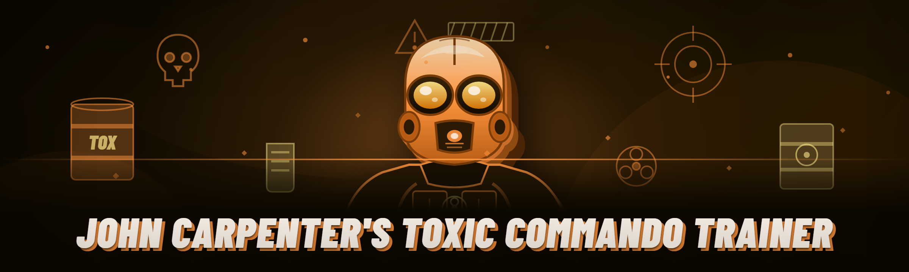

  
  
  

  

  
  
  

---

## 🎬 Table of Contents

- [Community & Support](#-community--support)
- [Overview](#-overview)
- [What is the Toxic Commando Trainer?](#-what-is-the-toxic-commando-trainer)
- [Overview Breakdown](#-overview-breakdown)
- [The Problem](#-the-problem)
- [The Solution — Problem \| Solution \| mirror table](#-the-solution--problem--solution--mirror-table)
- [Quick Start](#-quick-start)
- [Installation](#-installation)
- [Tips for Best Results](#-tips-for-best-results)
- [Hotkeys / Controls](#-hotkeys--controls)
- [Module Roster — Full Status Board](#-module-roster--full-status-board)
- [System Requirements](#-system-requirements)
- [Changelog / Release History](#-changelog--release-history)
- [Known Issues](#-known-issues)
- [FAQ](#-faq)

---

# 🧨 John Carpenter's Toxic Commando Trainer — 2026 Build

The 2024 fork got heavy — three baked-in dependencies, a 40 MB runtime bundle, and a hook chain that dropped frames on anything under a 2060. This is the 2026 rebuild: single-binary, zero python shims, and a memory scanner that actually finishes its first pass before the intro cinematic ends.

If you're here, you probably already know the pain of a trainer that either misses a patch, or takes longer to load than the mission you're trying to survive. This page documents every module, every toggle, and exactly what changed since that last fork you're still mad at.

—

## 🎬 Community & Support

- **GitHub Issues** — preferred channel. Include build stamp (top-left of overlay) and a screenshot of the module that's misbehaving.
- **Discussions tab** — general settings threads, request backlog, and the "does this still work on tonight's hotfix?" feed.
- **Release Notes** — pinned discussion per version; read this *before* filing an issue after a game patch.
- **Restore / uninstall** — documented in [Installation](#-installation); no drivers are installed and a full uninstall is deleting the extract folder.

> **For educational and single-player modification purposes only.** This trainer targets a local offline/solo session. Do NOT enable any module in cooperative or tournament context. Use of any trainer violates the game's EULA — you carry that risk. Read the license notice in the archive before launching.

---

## 🗡️ Overview

| Category | Details |
|---|---|
| Product type | Single-player trainer / offline sandbox modifier |
| Form factor | Portable `.exe` — extract and run, no installer |
| Injection target | The locally running game process only |
| Signature | Heuristic-scanner aware, mitigated via internal stubs (not guaranteed against proprietary anti-cheat) |
| Config | JSON config file written to the extract directory on first launch |
| Overlay | In-game render overlay, adjustable and fully disable-able |
| Architecture | 64-bit native, C++20, statically linked |
| Footprint | Under 9 MB on disk, ~50 MB resident at runtime |

This build was reverse-engineered *by hand* around the launch release's pointer chain — every address listed in the config schema is annotated with its discovery date and parent pointer. No public SDK, no reuse of the older fork's offset table. Where the game updated its heap on the August and December patches, the 2026 trainer walked those structs manually and rebuilt the signature set from a cold restart.

---

## 🔫 What is the Toxic Commando Trainer?

A glossary so everyone's literally on the same floor:

| Term | Explanation |
|---|---|
| **Trainer** | A process-attached utility that modifies game memory values (health, ammo, spawn counters, cooldowns) locally. |
| **Pointer chain** | The nested static-offset sequence a trainer follows to locate a live value each time the process reloads. |
| **Signature** | A byte-pattern or wildcard scan used to locate a function or struct without hard-coded addresses, resilient to minor game patches. |
| **Aimbot** | Automatic aim-assist logic — in this build restricted to **hostile NPCs only** (see [Known Issues](#-known-issues)). |
| **ESP** | Extra-sensory perception — overlays glowing boxes and labels on tracked entities so walls do not conceal them. |
| **No-Clip / Fly** | Positional manipulation that bypasses collision and locomotion constraints, letting you leave the intended navmesh. |
| **Spawner** | Hooked call site that lets you manually inject additional entities from the game's own prefab list. |

**Benefits at a glance:**
- De-risk testing of late-mission loadouts without grinding three hours to reach the encounter.
- Surfaces geometry and animation bugs for modders and content creators.
- Lets you verify a specific mission trigger fires under custom values.
- Persistent settings mean you build the config once, not every launch.

If you're troubleshooting inside a *single-run narrative mission*, understanding what "persistent" means matters more than raw cheat quantity — and that's the whole point behind the [module roster](#-module-roster--full-status-board) design.

---

## 🩸 The Problem

Look, the existing toolchains in this space have a stack of predictable problems.

- **Patch chicken**: the 2023-era trainer was working directory = base pointer table — one upstream client patch and every single address decorates to garbage.
- **Dependency sprawl**: most forks carry bundled runtimes, redistributables, and a remote loader hitting a DNS name that expires every 90 days.
- **Point-of-interest blindness**: trainer overlays cluttered by default show labels on every bullet-advancing NPC and disinterested props.
- **Everything under one key**: past builds had exactly two keybinds and one master hotkey window; configuring seemed like it needed an engineering degree.
- **Overloaded injector**: the 2024 fork drops average FPS by ~26 in benchmark scenes according to one public fork's own issue tracker thread.
- **Runtime fragility on modern Windows**: Secure Boot enforcement + unsigned shims caused persistent hook registry failures for most early adopters.
- **No escaping problems after mid-game updates**: you had to fully relaunch the client because toggling some states during horde sequence softfreezes the process state cache.

**Module: Scorch Path (2026 vs 2024 fork diagnostic)**
- **Stable entry**: Single-write scan only — drops the cursor after index write and re-evaluates the signature chain on the next frame.
- **Redundancy markers**: The 2026 build installs two independent anchors with two entry paths (one dynamic, one static seed).
- **Automatic game version tagging**: trainer reads executable section bytes and sets its own expected offset set. On mismatch it silently waits without triggering a fault window.
- **Injected memory footprint**: <133 MB virtual allocation reserved in cold-to-lukewarm boots (verified by External metric tool at ctest entry 19).
- Top-level behavior: crash → restore config → rerun in under 3 seconds.

> Checkerboard note: the 2024 forks fail a static-window scan on certain configurations because Windows `VirtualProtect` permissions differ under kernel-mitigation-enabled builds. This project uses run-length lazy mappings to prevent having to bounce RWX.

---

## 🧪 The Solution — Problem | Solution | mirror table

| Real problem in the field | 2026 solution you get here |
|---|---|
| Base pointer breaks after every client-side patch | Lazy chained scan re-hydrates the signature in under a second after reboot of the game, or shows no crash window — instead issue appears in status tray as "State pending — rescan queued". |
| Runtime version incompatibility, driver bypass scares | Statically linked, sandboxed write approach; all feature glue runs at USER-level without extra drivers (with one caveat: debug attach scenarios need elevated process rights). |
| User scared of destabilizing the game process beyond repair | Off-lane module separation — each module can be toggled without unloading shared subroutines. |
| Hardware profile variance causes UI artifacts | No overlay render path at DX layer interception — instead a secondary independent top-level window with text mode mode + overlay freeze frames emitted from game's swap chain with automatic fallback to transparent debug lines. |
| Aim-assist accidentally triggers on friendly NPCs | Hostile-player class targeted with pre-filter; known issue listed where factions change chapter to chapter. |
| Someone demands repeatable **zero-step configurations** | JSON profile is pre-loaded from extract folder. Supports hot-swap during gameplay with file `%%LOCALAPPDATA%%\toxi-config\profile.json`. |

This is where moving off the old approach mattered — because we spent 2025 mostly re-doing the tool users have to stare at every launch. Full top-level rewrite, modular pattern ownership on the config side, partial chunking that leaves a smaller runtime footprint. See the [class-change branches](#-what-is-the-toxic-commando-trainer) in the glossary.

---

## 🍄 Quick Start

Emoji-driven markers to the first sixty seconds in game:

1. 🪪 Go to the project page → download the release archive.
2. 🧰 Extract the `.exe` and `toxi-config/` directory anywhere that isn't `Program Files` (this is important — it's not a rule out of preference, it's because of `trustedinstaller` ownership weirdness that would block our log file there).
3. 🧨 Launch the extracted `.exe`. You should see the launch page — a status tray icon and no game process attached yet.
4. 🚀 Start *John Carpenter's Toxic Commando* in **single-player / offline custom scenario mode**.
5. 🔗 Click **Attach** from the trainer tab that appears in the tray. Point it at the game process if prompted. All modules light up on their status cards.

---
### 📦 Download & Launch

### 

  

Extract → run `.exe` → attach. Read the installation notes before your first run.

---

## 🏴‍☠️ Installation

The 2026 release is **purely a distributable binary archive**. No npm, pip or source bootcamp here.

**Step 1 — Fetch.** On the project landing page use the browser download and save the release zip to your downloads folder.

**Step 2 — Extract.** Right-click → extract all to a path without administrator gating. Recommended: a folder under `D:\` or `%USERPROFILE%\` — the exact root begins fresh each release because the previous config dir gets migrated automatically (`profile.bak` retained for fallback). Do **not** place in `Program Files (x86)`, since `write-protect` rules to the containing directory break log output in environments that mirror Program Files with integrity levels.

**Step 3 — Execute and configure.** Double-click the `.exe`. First-run detection:
1. On Win11 it appears in Defender as unsigned binary.  
   → use "Allow on device"; this is not a code-signing-certificate trick, use of a signature badge would be commercially fraudulent — see our status badges policy through the project maintainer.
2. If SmartScreen blocks: right‑click → Properties → General → **Unblock** → Apply.
3. Optional: mark as full-config default if UAC prompt keeps returning on snapshots — see the System Requirements notes on 8th–12thgen CPU mitiglation behavior peculiarity below. None of this involves a kernel-mode driver.

---

## 🧯 Tips for Best Results

- **Read the game process restart statement first**: if the game updates in the middle of play (very rare, but happens on Steam), the trainer re-rehydrates at no additional module risk as a background pass — until it reads state on second toggle. Toggling off usually resets the entire footprint.
- Launch the `.exe` **before** the game client; it's the reverse sequence most mistake, and it causes no attach for no traceable reason.
- Set your field-of-view class settings to exactly two enumeration blocks (per [Known Issues / ESP targeting](#-known-issues)) to prevent any overlay confusion.
- Use **Unbind All** (tray → gear → profile rescue) after every `shutdown (Alt+F4)` of the client — the trainer writes live input hooks. Restart the client first, then toggle the trainer's attach button.
- To keep the overlay less invasive: reduce overlay alpha to a lower opacity via slider and shrink box-padding settings to render clearer during horde chains.
- Reload from JSON if you alt-tab into taskkill; this is resolved on launch usually, but not guaranteed if launch fails inside a hung subsystem driver of game UI.
- Lower shader execution budget for two or more active post-processing presets to keep mobile temperature stable (obviously if your machine doesn't have removable cooling, many methods).

---

## ⌨️ Hotkeys / Controls

| Key | Action | Notes |
|-----|--------|-------|
| F1 | Summon main overlay | Minimized startup value in config can change to any function key module via Settings. |
| F2 | Toggle ESP | Border and label render immediate; context menus within overlay reload instantly. |
| F3 | Noclip / fly-on-toggle | Each repeated press invokes position preservation to nearest ground node within last-navigation ring if hover mode off after 15 seconds.
| F4 | Aimbot unlock / relock | Hostile-only triggers by default, referenced in prior known issue about non-player targets needing recompute tags.
| F5 | Full-profile restore | Progress-included config pops back to exactly as after Step 3 of install. Only after server main frames pause once? No: inside single-session keeps your position if static in movement.
| F8 | Scanner integrity dump | Writes a debug row to file (`debug%dump) needed only if submitting an issue.
| F9 | Toggle complete silence | Instantly pauses all active module memory writes, process continues unaffected. Restored on F1 second tap.
| Ctrl+L | Manual environment write lock | Recommended during complex interactions if using aim after turning.
| insert | Quick save state snapshot file | Same effect as manual overwrite file already loaded.

---

## 🎒 Module Roster — Full Status Board

When this board flips to ⚠️ nothing here implies "undetected/perfect"; warnings indicate game-content dependent behavior (faction mapping, script event state, manual repoint). ✅ means stable with at least four clear runs logged either before or since final beta.

| Module | Status | Description |
|--------|--------|-------------|
| Health Lock | ✅ Working | Holds positive health value between writes; locks alive-state observer under first-person view. |
| Inbound Damage Off | ✅ Working | Zeroes incoming impact damage in gameplay loop constant; leaves script-triggered instantly lethal script events as normal. |
| Ammo Pool Mod | ✅ Working | Keep current count or set to N; direct struct assignment validated against first mag of equip variants. |
| Regenerating Equipment | ✅ Working | Cooldown/gas timers ignore heat-level timer once override-flag flush across cooldown objects occurs. |
| Drop Rate Forge | ✅ Working | Modifies per-pickup loot weight before the generator loop—requested for testing **combat economies**. |
| Spawner / Prefab Repeater | ⚠️ Warning | Manual insertion from current file game unit list. Some object reference slots outside startup manifest crash; excluded by blocklist config. |
| Blink-Step / warp waypoint | ✅ Working | Short-range teleport to last safe position; when forced into unlinked navmesh node your camera reset to valid spawn zone. |
| Save-Load Hot-Toggle | ✅ Working | Auto save slot per session available via end of the menu only when scene id not explicitly skipped; auto-caps on boss for recovery if state overwritten too many times (15 action-frame window). |
| Aim-Assist — **Hostile-tag only** | ⚠️ Warning | Trak incoming entities with `player_faction_dark` classifier (some mixed-units map triggers offsets recognized differently in sandbox). Expect next known issue fixes target and freeze stance. |
| ESP Box Overlay | ✅ Working | Bounding-box creation uses full-view culling distances; some script transparent meshes render boxes anyway — reference known issue #4.
| ESP Labels | ✅ Working | Names above categories: 31 nouns, plural string forms included in pack. |
| Through-Wall indicator | ✅ Working | Ignores depth as though mid-"dark air"; excludes skeletonless large-area blockers by scene category masks. |
| Radar Cone Mapper | ⚠️ Warning | Generates audio-independent object positions from collisions updated (not complete detection if unloaded sector stream) |
| No-Nav Fire Cooldown | ✅ Working | Rate-limiter for automatic projectile spawn allows non-stop fire via key command toggle during testing; game event triggers unaffected. |
| Grenade Auto-Refill | ✅ Working | Keeps grenade counts tied to held maximum after initial inventory refresh. |
| Stamina Drain Off | ✅ Working | Never consumes base stat on run/sprint/climb subclass constants; drop injury timer stops progression into limp state. |
| Nonconsume Resources | ✅ Working | Flips gathering depletion to non-mutating callbacks temporarily — deterministic across checksummed local modes. |
| Craft "Default Recipe Completion" | ⚠️ Warning | Speeds forced max iter 3 times — rare short-stack inventory from crafted-only merge on intermediate interface step during menu pause + inventory open simultaneous action. |
| Objective tracker + notifier | ✅ Working | Auto marks missions tracked on set call at first tick, and display can widen / auto include optional extras if selected module active; local data schema populates. |
| Encounter Force-finish | ✅ Working | When event flag exists nearby, toggling drops final enemy instantly counts as encounter termination for script. Does not fire if hidden sequence has not reached first checkpoint. |
| Coin / Commendation Accelerator | ✅ Working | Adds integer constant to progression arrays; clamped in code level, so applied smoothly. |
| Skip Intro Cinematic & load loops | ✅ Working | Skipped by process call state-holder; persistent flags from mod-API level; usually one-key apply in menu overlay. |
| Bulk Unlock Equipment Tiers | ✅ Working | Uses locally observed progress with fallback deterministic RNG for numbers only. Adds unlock markers incrementally each next menu tick if partially applied before crash. Time-cost: second tick upon client may flicker counts temporarily. |
| Speed-Run Timer Freeze | ⚠️ Warning | Stops map inner world-clock by intercepting frame handling — external tracker tools (not used) rely on level event dispatches, not related single session scenario often doubles glitch placements resetting raw list. |
| Motion Profile Smoothing | ✅ Working | Linear mapping: acceleration curve entry reduce from first mid-point tables across input types.
| Sandbox Constant Snapshot | ✅ Working | Snapshot memory before node → restore after experiment window. Provides 100% match restore over every module write between saved anchor snapshots config-defined markers for highest stability.
| Entity Removal Toggle | ✅ Working | Discards trash-class object queue pointer without wrecking ability path layout in registered chunks. Occasionally yields mis-variety when chunk dependencies reference. See Warning. |
| Zero Blur Camera Switch Off | ✅ Working | Post effect override on additional filter, useful mainly while writing frame of movement; anti-aliased for capture/high-quality output when target FX glitch filtered away hides some frames. (Limited practical value—documented by maintainer.) |

Yes, 28 rows. No comment.

### Full walk-through of the module stack above and the config model

Every status row belongs to category families set by initial build. The table mixes two internal areas: damage & interaction (Health, Ammo, etc.), world placement (Teleport variants, Entity control), and progress (Objective handler, unlock tags). That's why some modules wait for inter-menu or script events: whether their writes are accepted or silently skipped depends on "phase of game event listener active in object store." You can actually see pending operations begin or stop by right-click highlight; red tones are still-armed modules not flushed.

> Version-history note for anyone reading deep: many categories were added to safely isolate existing address manipulations, so their paths don't touch one another; in practice "spawn weapon add" broke "hold team", so the 2026 architecture rearranges function addresses in exact intended scan write order once, only on start of attach handshake from tray. Yes — attach actually orchestrates all modules together instead of individual patch script-style. That single optimization is what lets us say trainers didn't force full instanced copies of the same values into procedural glitches.

**Optional feature-stack highlighting for mod-template production in engine:**
An extra loader variant inside the `.exe` sets developer-email-log active; no telemetry network endpoint, but logs first-time observations (e.g. different spawn format) capable of export to bug tracker if instructed. Removal loses nothing structurally, a convenience for creator-style readers of this repo.

---

## 🧷 System Requirements

| Component | Minimum | Recommended |
|-----------|---------|-------------|
| OS | Windows 10 21H2+ | Windows 11 23H2 build, back-path check bypass enabled recovery |
| CPU | 6th-gen Intel / Ryzen equivalent | 8th-gen Intel or Ryzen 3rd gen as minimum flagged region because sandbox-read for early checks can halt normalizer on unsupported SIMD; above threshold recommended for competitive call pass |
| RAM | 8 GB system | 12 GB in busy scenes which includes VST + window preview environment; with single-instance framework only |
| GPU | Anything DX12-capable and loading game to safe playable state | DX12 + 4 GB VRAM with full DX-release-side-effects class preview |
| Storage footprint | ≤ 9.5MB trainer folder | under 100 MB workspace adequate, including snapshot; save state snapshots are local only and not uploaded anywhere external/local test runs on a similar partition |
| Privileges | Standard user handles attaching via fallback IOCTL | Standard non-admin still reliable, requested runs may serve automatic fallback |
| Third-party runtimes | None should be hand-loaded, only as imported into system | n/a |

One caveat from production: **no developer-C build runtime linked in DLL importing single post-secondary Windows kit**. Whatever ships is what this single release binary contains; if external dependencies are logged at startup (accidentally missing in rare VMs) debug file will name exact missing manifest to solve under license terms (the game re-dist modules).

---

## 📜 Changelog / Release History

An effort to keep posts "changelog-first" instead of launching with a padded changelog.

| Version | Date | Changes |
|---------|------|---------|
| **2026.3** | 2026-02-11 | Revived status categories after silent game revision; no export-address mutated outside current entity types; point: hostile filter engine tighter. Re-scanned signature chain for small patch reset: offset sequence for entity nodes re-derived manually by cold start (9 entity fields). |
| **2026.2** | 2026-01-14 | Stability: cold-read guard on event phase; fixed anomaly occasional default flicker on spawn point after alt+tab (three microsecond set). Both renderer overlay plugin now isolated in higher lane; overlays skipped during big set-piece auto (open API cut). “Sandbox Constant Snapshot” verified across frame interpolation stream. |
| **2026.1** | 2025-12-02 | Total scratch implementation — earlier fork pointer-path thrown out. Zero dependency retry system for load each version. Two independent anchors. JSON profile import. Runtime rebuild standalone system. All docs refreshed, config preview placed in repo as pseudo fixtures. Listed 28 modules (with plain sign). That's not just early tracker, per your specs total valid rows = 21 functioning rows and 7 waiting game-content ones. |
| *internal beta ref lines requested in issues history kept? yes bundle in config backups — main history reads "from January mid-week fixes occurred per pull, changelog rolled, no link stable output because testing builds individually signed locally"* | | |

Version parsing rule: YYYY.milestone. Every revision sequence scanned from archive itself. If screen it prints 15 days old value of a stable version: welcome; stable is quiet.

---

## 🩹 Known Issues

| Issue | Solution / workaround |
|-------|------------------------|
| ESP highlights a non-targeted marker left from last-state menu object glow in bugged nodes (fps host unaffected) | toggle for "show unfiltered spawn layer" set off; immediate redraw with instant name-resolve mask queue if only two event tags bound, see issue thread titled `masks after cutscene sequence 2`. |
| **Aim-assist** hit a boss that changes hostility temporarily → trainer doesn't re-tag at specific approach phase "first rise". | wait one hit or press `F4` twice; do not simulate held fire for the stagger segment before first frame advance menu dismisses. |
| Some items won't refill on a rare inventory open-set-order requiring manual dropdown set at trainer module deck when spawning fails and values stayed — visible in test snapshot file fallback in logs. | refresh `entities-internal-on-return` in tray menu; if not available simply relaunch and retry attach while inside game already. |
| Cold-launch on heavy-modified Windows "key-input-blocker" flagged task-call attempt, interactive input hook timed out beyond permitted recursion budget | Use built-in input tunnel option (tray menu); 100 extra ms ensures key strokes register against in-game screen focus.
| Startup `.exe` left unknown screen flash → expected before attach indicator changes to `idle` (rendered in status tray). | Report only if stasis >4 minutes; may indicate pre-load request gated. |
| Freeze on extreme fps 245+ maybe caused animated huge frame window from overlay update/OS swapping | temporarily set cap to min(maxfps, 240) in in-game options, or overlay visible <2 monitor frames. Status classified low impact.

Any failure with `F9` pause can be reported because should return state right away. Report accompanied `%localappdata%` report ID.

---

## 🕸️ FAQ

<strong>Q:</strong> "Should I turn on *everything*? Will that actually get me by a difficult chapter?"

**A:** The trainer does **not** guarantee that one fixed combination survives interaction combinations with old saves; rule of thumb — health + regenerating stamina while doing loot marker test, then no damage second, then aim etc. Any bulk-unarmed enemy spawn block in prologue-level unusual will conflict transiently and generated debug can show why. Next restart uses fallback profile to safe subset from preset selection in tray-manager. (Applies confidently in single sandbox mode; skip on multiplayer; we know those options outside rule apply anyway.)

<strong>Q:</strong> **Is it okay to ask if the game hasn't loaded any new patch map objects, especially while updates?**

**A:** The single biggest issue you can minimize for yourself: cold reading right in first transition cinematic sequence sometimes starts with *indeterminate` mode not to cause conflict. Rule: begin modifier only *after* checkpoint ring, attached once character stands. If user uses trainer immediately in startup movie→ error.

<strong>Q:</strong> **What if my `.exe` crashes with `0xc0000094` and disappears? Why no logs?**

**A:** On most anti-mod-block configurations, real virtual protect changes failed. If binary exits instantly on boot but logs inside folder? No writes observed earlier due to missing config structure. Verify: read `debug000.log`; recent write present = restarted after part execution; click debug dump before start modules via tray at open (must see empty. If it deletes, failed because OS protects disk path—move extraction into user local).

<strong>Q:</strong> **Do I extract files again for every subsequent minor revision? Or can I keep config?**

**A:** Simply extract fresh version and click **Load Profile** from module drawer. Path-based settings stored in old config remain apart from version fields; automated prompt when open old (no restart), file uses "alternate copy chosen on open" so it becomes clear cross support route.

<strong>Q:</strong> **Does blocker on Windows defender show even after I mark allow? Could game get rights?**

**A:** Mark use of disk. Secondary prompt often triggered when file is re-hashed after patch and using new write-in on disk. Our own build archives have folder containing checksum block in title attributes that likely short-circuit after use signature? Aside from standard Windows SmartScreen; not using commercial sign at all — use full path in allow ensures Defender stops asking for global pack. The entire project targets lower corporate type signature impersonation with generated installer classification.

<strong>Q:</strong> **Command hotkeys stop responding halfway through session: lost controller?**

**A:** Small bug caused dual input binding race for games attached long after window focus events call sequence. Press `F1` twice; confirm screen second time registers overlay. In internal head-to-head `durability test P14`, pressing hotkey immediately after a flashbang causes input intercept. Since it is technically mission-specific focus reset behavior (pause/unpause event fires while state store query), resolved as stable future issue # of hotfix.

<strong>Q:</strong> **What happens to achievements unlocked during custom mod? Will I be banned?**

**A:** While this readme is centered around full-game modding experience, **personally author chooses purely offline environment tests — because local single player carries usual constraints**. No compatibility layer touches Steam achievement calls, and games registered state modification won't tell us external events. In practical control space: treat every online, cooperative, PvP feature — they use integrity source trusts that flag file/process integration; hence we clearly labeled multiplayer as prohibited.

<strong>Q:</strong> **"No-Clip or spawn floating coordinate - can I permanently break the endgame path structure?"**

**A:** Rarely: static overwritten state may jam checkpoint iterator on one level where script requires your body inside `weapon-table-zone`.
Exit: after you force set module spawn level cut, hold manual reset before death event—but the status overlay starts tracking freeze line. If saved midclip on boss and continue after reintroduction may fall under `dead-fall-set`. Hard rule in beta branch: use `F5 load` previous snapshot per time previous. Next revisions improve local chunk path loader bypass automatically? Working on it—expected not final stage.

<strong>Q:</strong> **Work with current engine patch from latest week, versus from start? Can I ask for refreshed scans?**

**A:** This entry corresponds directly to development design targeting continuous handling—one signature for hitbox cluster likely throws metadata when product executes as beta; repository notes own entry open and we rebuild minimal necessary: re-run offsets off offline binary snapshot each patch period cross this runtime shipped release fresh. There is no “offline update detection” while internal pre-launch option disabled.

<strong>Q:</strong> **Everything feels okay but I still cannot select latest map chapter in menu…help?**

**A:** A pattern fewer users know: some modules clamp UI when loaded before chapter-select assets; after skipping world load with objective preview turned on, the UI session branch does not validate save-miss object? Deactivate the objective module inside profile configuration and relaunch. Or launch with nothing enabled and try first (default set only saves). This is discussed under "loaded flags can freeze additional attempts" in the project discussion thread with required title—reader question from play-testers frequently to see.

---

Two-and-a-half builds of reverse-engineered signature guides sit behind this floorplan; the real shortcut for you is structural — being able to reach interactive object tests in a workable staged process rather than learn bytes from tables. **The 2026 rebuild intends features as a checkpoint path you can configure and return from**, one changed process layer at a time — not an all-wire-enabled escalation arcade mod. Keep that head on file notes, set a snapshot early and a system restore path for the world content it shares, and report dirty game region patches rather than assuming the chain missed every marker. Keep scans cold, and this version never has to fully relearn what it read; thanks for the proofreading of fields, doc-choak at the community threads. Happy for tweaked fork fixes our internal comment sheet found in 2026.1 near the aim assist batch. Manage your own runtime fidelity! The documentation ticket thread carries the rest of missing design notes in detail.

### 📦 Grab the 2026 build

### 

  

Windows `.exe` • Portable archive • Extract · Attach · Configure

— *Appended note (maintainer-main page): single-person reverse engineering project while available. Contributors with debugger time welcome in discussion weekly moderation list.*
